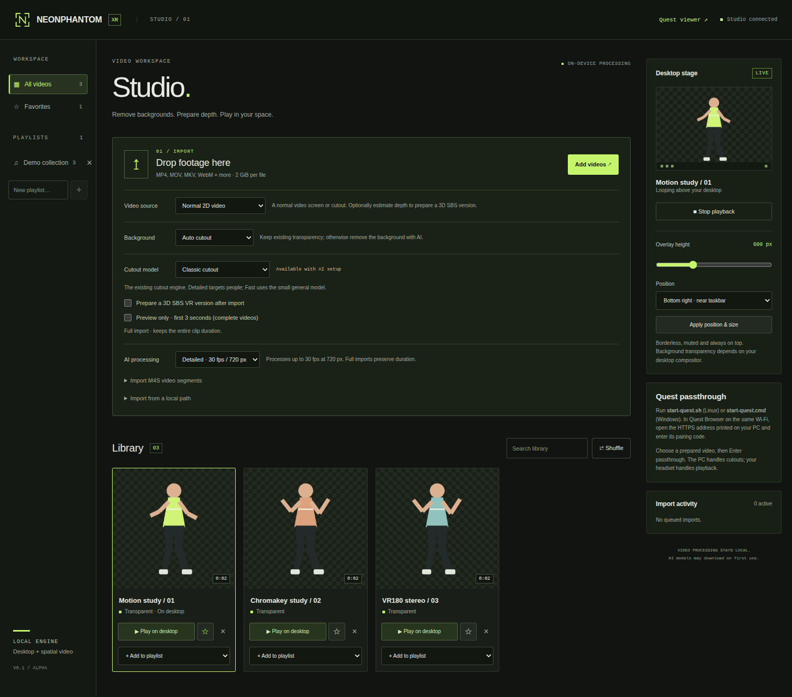
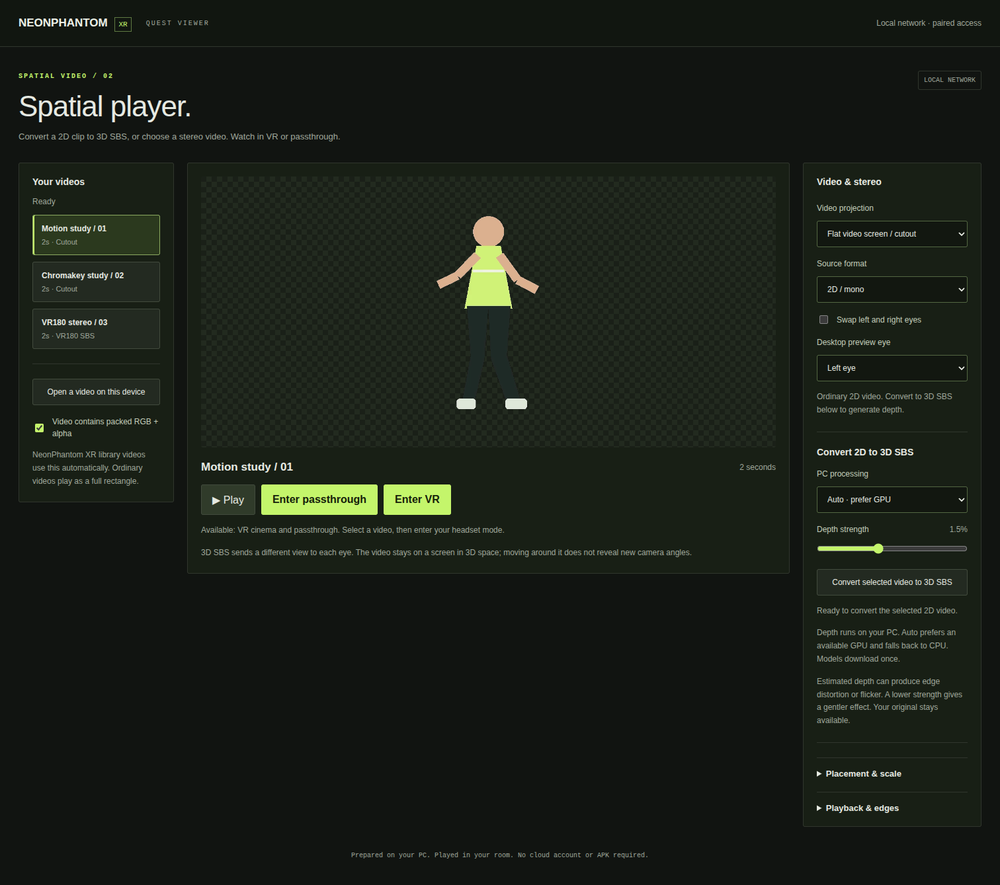

# NeonPhantom XR

**Local video cutouts, desktop overlays, and Quest passthrough.**

Remove a background, keep the subject, and play the result on your desktop or in your room. Prepare estimated 3D depth from a normal video, or preserve captured stereo when importing headset-ready VR180 SBS footage.



*Screenshots use generated geometric figures and invented library data. They demonstrate the interface, not AI matting quality.*


## What it does

- **Cutouts:** choose Classic, MatAnyone 2, or experimental WeVisOne 2B / 4B. Green/blue screen and existing-alpha modes are also available.
- **Desktop:** loop a transparent, borderless overlay on Linux or Windows.
- **Quest Browser:** pair over your local network and watch in VR or passthrough, with playback controls inside VR.
- **Stereo:** estimate depth for 2D-to-SBS conversion using the PC's GPU or CPU. Captured equirectangular VR180 SBS keeps its original left/right views while each eye is matted separately.
- **Private processing:** video processing runs on the PC. Setup and model downloads need internet; the headset streams from the PC over the LAN.



## Run the packaged app

Download the matching **NeonPhantom-XR-Linux-x64.zip** or **NeonPhantom-XR-Windows-x64.zip** from the repository's Releases page when published. Extract the entire archive into a writable folder. The built interfaces and backend are included; Python, FFmpeg, and platform playback dependencies are installed separately.

| Platform | Setup | Start |
| --- | --- | --- |
| Windows 10/11 x64 | Install Python 3.12 and FFmpeg, then run `setup-windows.cmd` | `start-windows.cmd` |
| Linux x64 (glibc 2.39+) | Install Python 3.12, FFmpeg/ffprobe, mpv, and a desktop compositor; see [Linux setup](BUNDLE-README.md) | `./start.sh` |
| Quest on your LAN | Run `setup-quest.sh` on Linux; Windows setup includes the companion's packages | `start-quest.sh` or `start-quest.cmd` on the PC |

Open the desktop studio at **http://127.0.0.1:8321/**. For Quest, open the HTTPS LAN address printed by the companion and enter the code shown on the PC. See the [headset guide](QUEST-README.md) for the local certificate setup and GPU depth runtime.

## Build from source

Requires **Node.js 22.17+ (24 recommended), current stable Rust/Cargo, Python 3.12, FFmpeg and ffprobe**. Linux desktop playback additionally requires mpv and a compositor. Windows uses PySide6.

```sh
cd frontend
npm ci
npm run build
cd ../quest/app
npm ci
npm run build
cd ../..
cargo build --release --locked --manifest-path deskdanced/Cargo.toml
```

Then follow the platform setup above. The internal `deskdanced` executable name and `DESKDANCE_*` environment variables remain compatible with earlier installations.

## Alpha status

This is a **0.1.0 alpha**. Synthetic conversion, API security, stereo rendering, and emulated Quest controller flows are tested. Physical Quest playback, visual comfort, real VR180 matting quality, and native Windows execution still need hardware validation. Estimated depth can distort edges; it does not create unseen camera angles or room occlusion. Raw dual-fisheye capture needs stitching before import. Desktop imports are muted.

## Development and releases

```sh
python -m pip install -r requirements-quest.txt cryptography
python -m unittest discover -s tests -v
npm run test:security --prefix frontend
cargo test --locked --manifest-path deskdanced/Cargo.toml
python scripts/release_audit.py
python package_release.py --platform source
```

See [release instructions](RELEASING.md), [security review](SECURITY-REVIEW.md), [security policy](SECURITY.md), [API](API.md), [model setup](MODEL-UPGRADE.md), and [Windows guide](WINDOWS-README.md).

## License

App code is [MIT licensed](LICENSE). Third-party code, runtimes, and optional models retain their own licenses; see [third-party notices](THIRD-PARTY-NOTICES.txt). Model weights, personal footage, pairing credentials, and DRM tools are excluded from the source and release archives.
